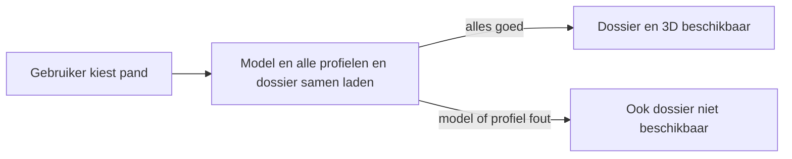
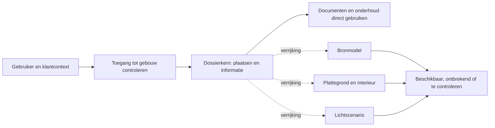

# Herbruikbaarheid, aanpasbaarheid en productuitrol

Audit op 20 november 2026. Uitgangspunt: de werkende versie op commit `5a1b936`, met de configuratie- en installatieverbeteringen die hieronder apart staan. Opdracht: snel opnieuw kunnen inzetten voor particulieren, kantoren en andere panden. De huidige twee dossiers zijn praktijkvoorbeelden, geen bewijs van een compleet klantenplatform.

## Conclusie

**Er is een bruikbare gedeelde dossierkern. Een volgend pand is nog geen herhaalbare productoplevering.** De grootste beperking is de koppeling van de gewone dossierfunctie aan het 3D-model en de handmatige installatie. Voor kantoren ontbreken bovendien een organisatie-/rechtenmodel, meerdere bouwlagen en bewezen afhandeling van grotere documentverzamelingen.

Een product opleveren omvat ook: toegang geven, gegevens invoeren, fouten herstellen, updates uitvoeren, eigenaarschap overdragen en gegevens teruggeven. Alleen een extra adres in een selector toevoegen dekt dat niet. De gebruiker heeft tijdens deze audit expliciet bevestigd dat **alle drie de leveringsvormen mogelijk moeten zijn: Geokari richt in/beheert, zelf online starten, en een eigen installatie bij de klant**. De onderstaande technische voorstellen zijn aanbevelingen; leverancier, toegangsbeleid en de eerste oplevervolgorde zijn daarmee nog niet gekozen.

## Reikwijdte en bewijs

Gecontroleerd: configuratie en alle vier importcommando's, serverstart, API, opslag/migraties, dossierimport, personen/onderhoud, dossierladen en navigatie, profielschema's, buiten-/interieurregistratie en bestaande integratietests. Renderingmodules zijn gericht gelezen op invoer, grenzen en verborgen aannamen; geen volledige nieuwe geometrie-audit. Geen belastingtest, pentest, juridische toets, nieuwe klantimplementatie of kantoorinterieur opgeleverd.

De productrichting komt uit het bestaande concept: kennis bij een plek, historie en onderhoud, eerst het eigen huis, daarna andere gebouwen. De nieuwste gebruikersinstructie voegt expliciet **snel neerzetbaar product, ook voor kantoren, met alle drie de leveringsvormen** toe (chat 20 november 2026). Scenariovoorbeelden voor kantoren hieronder zijn auditproeven en moeten nog met een echte kantoorklant worden gevalideerd.

## Concrete veranderproeven

| Proef                                                    | Wat vandaag kan                                                  | Wat nog maatwerk of een productkeuze vraagt                                              |
| -------------------------------------------------------- | ---------------------------------------------------------------- | ---------------------------------------------------------------------------------------- |
| Nog een Nederlandse woning toevoegen                     | Eigen catalogusitem, BAG-import, eigen dossier-ID en onderdelen  | Geen begeleide onboarding; modelimport en oplevercontrole door technisch beheerder       |
| Nog een Vlaams pand toevoegen                            | GRB-import met gecontroleerde contour/hoogtebron                 | LoD 1 is geen uitgewerkt dak/gevel/interieur; Nederlandse lichtimport is niet toepasbaar |
| Een kantoor zonder 3D beginnen met facturen en meldingen | Opslag/API kunnen onderdelen en klussen bewaren                  | De frontend en export vereisen nog een model; dossierstart zonder model werkt niet       |
| Een vergaderruimte, installatie of contract toevoegen    | Eigen onderdelen en vrije notities/documentcategorieën           | Geen kantoorstartpakket met versiebeheer of structurele aanvullende velden               |
| Een kantoor met drie verdiepingen inrichten              | Eén privéplattegrond met rooms, muren en inrichting              | Geen bouwlaaghiërarchie, verdiepingskeuze of meerdere registraties                       |
| Een andere gevelkleur of een ander daktype uitwerken     | Profielmaterialen en generieke bronvlakken zijn deels instelbaar | Gedetailleerde gevel-/daklaag bevat nog specifieke vorm- en kleurkeuzes                  |
| Eén bedrijf met verschillende locaties beheren           | Meerdere panden in één installatie                               | Geen organisatie, ledenbeheer of rechten per locatie                                     |
| Een externe vakman toegang geven tot één toestel         | Vakpersoon als naam vastleggen                                   | Geen login, uitnodiging, beperkte toegang of intrekken van die toegang                   |
| Dezelfde update aan alle klanten leveren                 | Eén gedeelde codebasis en additieve DB-migraties                 | Geen releasepijplijn, uitrolgroepen, terugrol- en herstelproef per installatie           |
| Een huis verkopen of een beheerder vervangen             | Volledige export beschikbaar                                     | Geen geteste JSON-import, overdrachtsflow of bewaarbeleid                                |

## Wat al goed herbruikbaar is

1. **Vaste dossier-ID's staan los van de mesh.** Onderdeel-, kamer- en bestandskoppelingen hoeven bij een nieuw aanzicht niet opnieuw gemaakt te worden. Zie [opslag](../server/store.mjs), [ruimtedossier](../src/DossierHome.tsx) en [registratie](../src/houseFrame.ts).
2. **Brongeometrie en privéafwerking zijn gescheiden.** De ruwe open brondata kan behouden blijven terwijl bewonersfoto's, afwerking en interieur apart veranderen. Dit is ook belangrijk voor licenties en onzekerheid; visuele verfijning maakt een registratie niet ingemeten.
3. **Meerdere panden zijn al in werkende queries en bestanden begrensd.** De bestaande tests voeren kruisverwijzingen tussen panden uit. Dat is waardevol, maar bewijst nog geen toegangsscheiding tussen klanten of gebruikers.
4. **Dossierimport heeft stabiele sleutels en behoudt eigen wijzigingen.** Herimport kan daardoor herhaald worden zonder afgeronde klussen of aangepaste dossiers blind te vervangen. Zie [import](../server/import-dossier.mjs).
5. **Ingericht en oningericht komen uit één bronprofiel.** Dat voorkomt twee handmatig uiteenlopende modellen. Zie [weergaveafleiding](../src/furnishings.ts).
6. **Kernhandelingen zijn grotendeels generiek.** Documenten, plaatsen, meldingen, resultaat, personen en onderhoudsafspraken zijn ook bij een kantoor bruikbaar. Er hoeft geen tweede onderhoudsapp naast de woningversie te ontstaan.

## Bevindingen en prioriteit

P0 = blokkeert de genoemde productvorm; P1 = nodig voor herhaalbare oplevering of het genoemde gebruik; P2 = verbeteren zodra die behoefte is bevestigd. Dit zijn afhankelijkheden, geen doorlooptijdschattingen.

| ID  | Prioriteit                       | Bewijs en gevolg                                                                                                                                                                                                                                    | Gewenste verandering / toets                                                                                                                                                                                                                                                     |
| --- | -------------------------------- | --------------------------------------------------------------------------------------------------------------------------------------------------------------------------------------------------------------------------------------------------- | -------------------------------------------------------------------------------------------------------------------------------------------------------------------------------------------------------------------------------------------------------------------------------- |
| R1  | P0: snelle dossierstart          | [main.tsx](../src/main.tsx), `Promise.all` en `!data`: model, dossier en alle profielen moeten tegelijk slagen. Ook een ongeldig optioneel profiel blokkeert documenten en onderhoud. [app.mjs](../server/app.mjs), export: modelbestand verplicht. | Dossier met alleen adres en plaatsen kunnen openen, vullen en exporteren. Verrijkingen afzonderlijk laden; fout bij 3D mag het dossier niet blokkeren.                                                                                                                           |
| R2  | P0: gedeeld online product       | [app.mjs](../server/app.mjs), globale loopback/Host/Origin-controle; [management.mjs](../server/management.mjs), personen als lokale records. Er is geen aangemelde identiteit of toegangstoets per gebruiker.                                      | Authenticatie en lidmaatschap expliciet ontwerpen. Alle bestanden, modelprofielen, exports en mutaties aan dezelfde toegangstoets onderwerpen. Geen bestaande personennamen stilzwijgend naar accounts promoveren.                                                               |
| R3  | P0: meerdere klantorganisaties   | [store.mjs](../server/store.mjs), `houses → assets → tasks/attachments`; alle mensen hebben een `house_id`. Er is geen klant/organisatie boven panden en geen portfolio-lidmaatschap.                                                               | Onderscheid klantorganisatie, locatie/gebouw, plaats, account/lidmaatschap en contact. Eén organisatie met twee panden en een beperkt toegankelijke locatie aantoonbaar testen.                                                                                                  |
| R4  | P1                               | Installatie gebruikte verspreide paden naar de bronconfiguratie. Lichtimport en Vlaamse bronarchivering gebruikten vaste `data/`-paden. Een vergeten importargument koos het eerste eigen huis.                                                     | **In deze ronde verbeterd:** gedeelde gevalideerde runtimeconfig, eigen catalogus/data/modellenpad, expliciet import-ID en bronbewaking voor lichtimport. Zie verderop.                                                                                                          |
| R5  | P1                               | Configuratie uit JSON vereiste handmatige kennis. Standaardonderdelen kregen altijd kind `installatie`; gewone ruimtes/onderwerpen waren daarmee geen correct startpakket.                                                                          | **Deels verbeterd:** getypeerde startonderdelen en controle op dubbele/gereserveerde sleutels. Nog nodig: onboarding met voorbeeld, controle, bevestiging en herhaalbare uitvoering, plus versionering van startpakketten.                                                       |
| R6  | P1: kantoor met bouwlagen        | [floorplan.mjs](../server/floorplan.mjs) en [types.ts](../src/types.ts): één outline, ceiling, plafondhoogte en spawn. Grenzen onder meer ±100 lokale meters, maximaal 100 rooms en plafondhoogte 2–5 m. Geen bouwlaag-ID.                          | Eerst model `gebouw → bouwlaag → ruimte` uitwerken en bestaande kamer-ID's behouden. Een echte kantoorcasus gebruiken; schemawaarden niet blind ophogen. Geen huidige claim op hallen, atria of een groot kantorencomplex.                                                       |
| R7  | P1: goedkope 3D-verrijking       | [houseEnvelope.ts](../src/houseEnvelope.ts), `frontRelief`: onder meer een vaste blauwgrijze kozijnkleur. [appearance.mjs](../server/appearance.mjs): een bepaald front-/dak-/achterbouwprofiel.                                                    | Onderbouwde materiaal- en vormparameters losmaken van de generieke renderer. Bewezen vormfamilies met expliciete mogelijkheden; geen naamloze verzameling `if klant X` of afzonderlijke klantforks. Andere vorm eerst met eigen bronmateriaal valideren.                         |
| R8  | P1                               | Gevel-/plattegrondprofielen worden met de hand op schijf gemaakt. [houseFrame.ts](../src/houseFrame.ts), `rearSurface`: een bronvlakindex verankert een deel van de buitenlaag. Herimport kan die betekenis wijzigen.                               | Bronmodelhash/versie en semantische referenties bewaren. Bij bronwijziging registratie als te controleren markeren. Oplevering kan per detailniveau verschillen, maar dossierkoppelingen moeten gelijk blijven.                                                                  |
| R9  | P1                               | DB-migraties bestaan, maar gevel, plattegrond en export hebben eigen versievelden zonder herstel-/upgradeketen. [app.mjs](../server/app.mjs) bouwt export `schemaVersion: 1` op, inclusief later toegevoegde velden.                                | Vastleggen welke wijzigingen additief zijn en welke migratie vragen. Voor elke ondersteunde oude versie een lees-/migratiefixture en een gecontroleerde fout voor nieuwere, onbekende versies. Exportversie mag alleen wijzigen met bijbehorende lezer/compatibiliteitscontract. |
| R10 | P0: betrouwbaar klantbeheer      | [README](../README.md#data-en-back-ups): JSON-herstel ontbreekt. Export omvat bestanden en profielen, maar is geen bewezen herstelproces.                                                                                                           | Import in een lege geïsoleerde installatie, controle op aantallen/ID's/bytes/koppelingen en pas daarna omschakelen. Herstel daadwerkelijk oefenen. RPO/RTO en bewaartermijnen met leverancier/klant afspreken; geen willekeurige belofte invullen.                               |
| R11 | P1: meer documenten              | [store.mjs](../server/store.mjs), `dossier` laadt alle metadata/taken; `searchFiles` haalt alle documenttekst op en zoekt in JS. [app.mjs](../server/app.mjs), export verzamelt alle originele bytes/base64 in geheugen.                            | Representatieve dossiers meten. Daarna paginering, gerichte indexen en volledige-tekstzoekindex waar nodig; grote exports als streaming pakket. Uploadlimiet per bestand is geen totaalquotum.                                                                                   |
| R12 | P1: tegelijk samenwerken         | Mutaties hebben geen recordversie/ETag. Bij gelijktijdig bewerken kan de laatste opslag de vorige overschrijven. De invoer-opslagcode voorkomt dubbele nieuwe invoer, niet conflicten tussen redacteuren.                                           | Versienummer bij lezen, conflictmelding bij opslaan en behoud van beide concepten. Test met twee gelijktijdige gebruikers. Geen volledige event sourcing nodig om dit probleem op te lossen.                                                                                     |
| R13 | P1: bedrijfsverantwoordelijkheid | [management.mjs](../server/management.mjs): recente activiteit heeft labels en tijdstippen, maar geen geauthenticeerde actor, voor/na-versie of complete veranderhistorie.                                                                          | Onderscheid bewonershistorie, operationele logging en controleerbare audit. Relevante wijzigingen aan actor/organisatie/pand/recordversie koppelen zodra accounts bestaan.                                                                                                       |
| R14 | P1: veilig uitbreiden            | Paginanamen bestaan zowel in [houseSelection.ts](../src/houseSelection.ts), [WorkspaceChrome.tsx](../src/WorkspaceChrome.tsx) als `Page` in [main.tsx](../src/main.tsx). TS-types en server-Zod-schema's zijn afzonderlijke contracten.             | Eén getypeerd paginaregister en gedeelde wire-schema's. `main.tsx` splitsen rond dossierladen, document-/taakpagina en dialoogflows; grenzen volgen verantwoordelijkheden, geen willekeurig aantal regels.                                                                       |
| R15 | P1                               | Geen repository-CI of geautomatiseerde release-/uitrolbeschrijving gevonden. De functionele tests zijn lokaal sterk, maar installeren/upgraden/herstellen is geen automatische opleverproef.                                                        | CI met tests, build, versieregels en installatie-/migratie-/herstelproef op synthetische data. Eén gebouwde versie promoten; klantgegevens/configuratie niet in de codebuild opnemen.                                                                                            |
| R16 | P2: kantoorprocessen             | Rollen `resident/helper/professional`, teksten over huis/bewoner en maandintervallen komen uit de eerste casus. Een contactrol is geen toegangsrol.                                                                                                 | Woordenboek per gebruikscontext en startpakket voor kantoor. Wekelijkse controles, teams, goedkeuringen of SLA's alleen toevoegen met een concreet bevestigd proces.                                                                                                             |
| R17 | P1: meerdere bronnen/landen      | NL en Vlaanderen hebben eigen importers; `rd` betekent in Vlaanderen Lambert 72. Lichtprofiel heeft `Europe/Amsterdam`, onderhoud gebruikt `Europe/Brussels`. Geometrie en documentmarkeringen veronderstellen hetzelfde lokale stelsel.            | Expliciet CRS/hoogtereferentie/tijdzone in het pand-/modelcontract. Geen conversie gokken op basis van land of veldnaam. Nieuwe bronadapter moet identiteit, CRS, eenheden, brondata en ontbrekende mogelijkheden aantonen.                                                      |
| R18 | P1: privacy en overdracht        | Profielen zijn privé, maar standaardmodellen staan onder het publieke/versiebeheerde bronpad. Publicatie van een adres of afgeleide privégegevens is een andere afweging dan de open geometrie. Geen bewaartermijn/verwijder-/overdrachtsflow.      | **Deels verbeterd:** eigen modellenmap buiten de checkout mogelijk. Nog nodig: veldclassificatie, doelgebonden toegang, export/overdracht en gecontroleerde verwijdering met back-upbeleid. Dit document is geen juridische toets.                                               |
| R19 | P1: pand uit beheer nemen        | Alleen catalogus wijzigen liet een bestaand DB-pand voorheen via de API bereikbaar. Het record bleef bestaan.                                                                                                                                       | **In deze ronde verbeterd:** alle huisgebonden API-routes vereisen ook huidig cataloguslidmaatschap. Gegevens blijven behouden. Dit is geen wissen en geen gebruikerstoegangsmodel; heractivering werkt door opnieuw configureren.                                               |
| R20 | P2: onderhoudbaarheid            | Bronafgeleide modellen, handmatige profielen, versie-informatie en tests hebben verschillende levenscycli. Alleen een succesvolle build ziet ontbrekende textuurbestanden niet.                                                                     | **Deels verbeterd:** read-only installatiecontrole op catalogus/model-ID/bronlabels/profielen/textuurbestanden. Nog nodig: DB-/uploadintegriteit, bronregistraties en herstelcontrole; een groene controle is geen volledige productcertificering.                               |

## Aanbevolen productgrenzen

Een aanvullende importgrens: de gebouwimporters schrijven het uiteindelijke modelbestand direct weg. Voor een klantgestuurde import is een expliciet proces nodig met voortgang, gecontroleerde tussenuitvoer, atomische promotie naar de actieve versie en behoud van de vorige versie. Een herhaalde dossierimport is al beschermd tegen verlies van eigen bewerkingen; dat bewijst niet dat het vervangen van een model even robuust is. Dit hoort bij de installatie-/updateproef van R8, R9 en R15.

Behoud één kern voor **plaatsen, informatie, bestanden, meldingen, onderhoud en historie**. Maak daarnaast expliciet onderscheid tussen:

- **Installatie:** uitvoerbare softwareversie, opslag, logging en back-upvoorziening.
- **Klantorganisatie:** eigenaarschap, leden en toegangsbeleid; kan één particulier huishouden of een bedrijf zijn.
- **Gebouw/locatie:** adres, bronnen, tijdzone en optionele modellen.
- **Plaats:** gebouwdeel, bouwlaag, ruimte, installatie of onderwerp met een vast ID; niet een mesh-index.
- **Contact:** iemand over wie het dossier informatie bewaart. Kan een vakman zonder login zijn.
- **Account/lidmaatschap:** geverifieerde gebruiker met rechten binnen een organisatie en eventueel een beperkte locatie.
- **Startpakket:** een versie van standaardonderdelen/labels/invoerkeuzes voor een bevestigde gebruikscontext. Geen automatische onderhoudsfeiten en geen apart programma per klant.

Dit zijn voorgestelde grenzen. Naamgeving van de bestaande API/database hoeft niet in één grote hernoeming te veranderen. Eerst de betekenis en migratie vastleggen; bestaande URL's en ID's behouden waar mogelijk.

Huidig laadgedrag:

Voorgestelde grens:

Een modulaire applicatie is hiervoor een passende vervolgstap: scheid modules en contracten binnen dezelfde codebasis. Er is op basis van deze audit geen aantoonbare reden om eerst microservices, een algemeen pluginsysteem of een nieuwe 3D-engine te bouwen.

## Alle drie de leveringsvormen ondersteunen

Dit zijn drie gewenste productvormen, geen drie klantforks. Bovendien zijn **begeleiding** en **technische isolatie** verschillende assen: een Geokari-beheerd dossier kan in gedeelde of afzonderlijke infrastructuur draaien. Selfservice betekent niet automatisch een aparte installatie. Een eigen klantinstallatie kan nog steeds door Geokari worden ondersteund.

| Leveringsvorm               | Gebruiker begint zo                                              | Wie beheert volgens het nog uit te werken contract                                  | Nodig naast dezelfde dossierkern                                                                                                 |
| --------------------------- | ---------------------------------------------------------------- | ----------------------------------------------------------------------------------- | -------------------------------------------------------------------------------------------------------------------------------- |
| Geokari ontzorgt            | Geokari importeert en richt in; klant controleert en gebruikt    | Geokari voor afgesproken hosting/updates/herstel, klant voor inhoud en bevoegdheden | Beheerdersworkflow, importpreview, overdracht, ondersteuning en expliciete ondersteuningstoegang                                 |
| Zelf online starten         | Klant maakt organisatie en eerste pand aan                       | Geokari beheert platform; klant beheert leden en inhoud                             | Veilige signup, organisatieprovisioning, uitnodigingen, voortgang/fouten opnieuw proberen, quota en beëindigen                   |
| Eigen installatie bij klant | Beheerder installeert een versie en initialiseert de organisatie | Klant of afgesproken beheerder; verantwoordelijkheden expliciet overdragen          | Versiegebonden installatiepakket, configureerbare identiteit/opslag/mail, upgrade- en herstelprocedure en overdraagbare diagnose |

Gemeenschappelijk blijven datamodel, API-contracten, documenten/onderhoud, templates, bronadapters en 3D-viewers. Verschillen horen in **geverifieerde installatieprofielen en begrensde infrastructuuradapters**, bijvoorbeeld identiteit, bestandsopslag, achtergrondtaken en mail. Een installatieprofiel legt ook vast welke mogelijkheden werkelijk beschikbaar zijn. Selfservice en klantinstallatie mogen geen kopieën van bedrijfsregels of rendercode krijgen. Dit adaptervoorstel is nog niet geïmplementeerd.

Online- en klantinstallaties moeten dezelfde negatieve toegangstests en dezelfde data-upgrade-/herstelproeven doorlopen. Een lokale één-gebruikerstand kan alleen expliciet lokaal blijven; een instelling voor publieke hosting mag geen impliciete uitschakeling van toegangscontrole zijn. Klantdata moeten tussen de vormen overdraagbaar worden met behoud van IDs, geschiedenis en originele bytes; een JSON-export zonder geteste import voldoet daar nog niet aan.

### Technische huisvesting is een afzonderlijke keuze

| Vorm                                                               | Voordeel                                                                            | Kosten en risico's                                                                                                     | Nog te bevestigen                                                                |
| ------------------------------------------------------------------ | ----------------------------------------------------------------------------------- | ---------------------------------------------------------------------------------------------------------------------- | -------------------------------------------------------------------------------- |
| Afzonderlijke installatie per klant, beheerd door Geokari of klant | Heldere operationele grens; bestaande lokale opslag kan als basis dienen            | Accounts/online beveiliging blijven nodig; veel installaties vragen automatische updates, monitoring en herstel        | Wie beheert, betaalt en oefent herstel? Hoeveel klanten en welke bereikbaarheid? |
| Gedeelde online applicatie met klantorganisaties                   | Eén gezamenlijke release, selfservice later mogelijk                                | Toegangsscheiding moet overal kloppen; impact van fouten en gedeelde capaciteit groter; control plane/onboarding nodig | Portfolio's, rechten, gewenste schaal, opslag en gegevenslocatie                 |
| Installatie bij de klant / beperktere lokale versie                | Eigen beheer en gegevenslocatie mogelijk                                            | Installatie/support/updates/back-ups vragen een verantwoordelijk beheerder; samenwerken niet vanzelf geregeld          | Welke klant kan dit beheren? Is lokaal onderdeel van de propositie?              |
| Bestaande generieke diensten inzetten                              | Identiteit, mail, bestandsopslag en monitoring hoeven niet allemaal zelf ontwikkeld | Leverancierscontract, kosten, exporteerbaarheid en integratie moeten worden onderzocht                                 | Welke omgeving past bij Geokari en de eerste klant?                              |

Mijn aanbeveling voor de code ondersteunt alle drie: één gedeelde kern, klantdata buiten de codebuild, expliciete organisatie-/gebouwcontext en een herhaalbare installatieproef. Kies hosting-/opslagdiensten op de operationele eisen van de eerste concrete uitrol, zonder een andere gewenste leveringsvorm onmogelijk te maken. De bestaande toepassing blijft lokaal; in deze ronde is niets online gezet.

Microsoft onderscheidt expliciet begeleide versus automatische onboarding, vereiste oplevertijd en herhaalbare automatisering. Dat ondersteunt bovenstaande beoordelingsvragen; het verplicht Huisdossier niet tot Azure. Zie [deployment en configuratie van multitenant oplossingen](https://learn.microsoft.com/en-us/azure/architecture/guide/multitenant/approaches/deployment-configuration).

Bij online toegang moet autorisatie op iedere aanvraag werken, ook op downloads en exports. Zie [OWASP Authorization Cheat Sheet](https://cheatsheetseries.owasp.org/cheatsheets/Authorization_Cheat_Sheet.html). De huidige `house_id`-filters en configuratielijst vervangen die controle niet.

SQLite is op zichzelf geen bewijs dat het product niet schaalbaar kan worden. De [SQLite-documentatie](https://sqlite.org/whentouse.html) maakt vooral onderscheid in schrijvers/concurrentie, serveropzet en netwerkbestandsgebruik. Eerst echte belasting en uitrolvorm meten; meerdere webservers, veel gelijktijdig schrijven of centraal gedeelde opslag kunnen een client/serverdatabase rechtvaardigen. Deze audit heeft die belasting niet gemeten.

## Verbeterd in deze ronde

- `server/runtime-config.mjs` is de gedeelde ingang voor server én importers. Catalogus wordt gevalideerd vóór de server de DB opent: veilige en unieke dossier-ID's, ondersteunde bron, BAG-ID waar vereist en unieke, niet-gereserveerde startonderdelen. Typefouten worden niet stilzwijgend genegeerd.
- `HUISDOSSIER_HOUSES_FILE`, `HUISDOSSIER_DATA_DIR` en `HUISDOSSIER_MODELS_DIR` laten één codeversie met installatiegebonden bestanden werken. De bestaande paden blijven standaard. Dit zijn vertrouwde beheerdersinstellingen, geen door gebruikers te wijzigen toegangstokens.
- Het model wordt via een huisgebonden API geladen; API en export gebruiken dezelfde ingestelde modellenmap en controleren de dossier-ID. Modellen hoeven bij nieuwe installaties niet in de checkout te staan.
- Een startonderdeel kan onder meer een ruimte of onderwerp zijn; bestaande startonderdelen houden standaard `installatie`. Opnieuw starten behoudt eigen bewerkingen.
- `import:house` vraagt expliciet het dossier-ID. Nederlandse lichtimport weigert een Vlaamse configuratie vóór netwerkverkeer. Lichtdata en Vlaamse bronarchivering volgen de ingestelde privémap.
- Niet meer geconfigureerde dossiers zijn via de huisgebonden API niet bereikbaar; hun DB-gegevens worden behouden. Er zijn geen bestaande dossiers verwijderd.
- `npm run check:installation` controleert installatiebestanden zonder DB aan te maken, records te seeden of netwerkbronnen op te halen. Afwezige optionele profielen zijn toegestaan; ongeldige profielen, ontbrekende texturen en fout gekoppelde modellen worden gemeld. De controle zegt expliciet dat gedeelde hosting niet gereed is.

Zie [installatiehandleiding](installation.md). Er is geen onboardingwizard, accountvoorziening, optioneel model in de dossierflow, herstelimport of kantoorbouwlagenmodel gebouwd.

## Volgorde met acceptatiecriteria

1. **Dossier starten zonder 3D.** Een schoon particulier- en kantoordossier kunnen openen, plaatsen maken, notitie/foto/melding opslaan en exporteren zonder geometrie. Een ongeldig verrijkingsprofiel mag deze handelingen niet blokkeren.
2. **Eén pilot opleveren via één herhaalbare procedure.** Startpakket, catalogus, personen/contacten, importpreview, bronstatus en installatiecontrole. Geen klantcode wijzigen. Tijd en handwerk registreren; eerst meten voordat een belofte als “in tien minuten klaar” wordt gedaan. 3D-detail apart begroten en opleveren.
3. **Alle drie de leveringsvormen uitwerken vóór externe toegang.** Per vorm een installatie-/beheercontract en acceptatieproef. Gemeenschappelijk: account versus contact, organisatie versus gebouw, beheerder versus invoerder versus lezer, tijdelijke vakmantoegang, portfolio en beëindigen. Daarna negatieve isolatietests voor API, modellen, originelen en export. Herstel in een lege installatie en overdracht tussen leveringsvormen bewijzen vóór een betaalde beheerdienst.
4. **Kantoorcasus met een echte indeling valideren.** Bouwlagen, gedeelde ruimte/installatie en verantwoordelijk team doorlopen. Hetzelfde kernproces gebruiken; ontbrekende eisen expliciet vastleggen. Grootte-/concurrentieproeven baseren op deze concrete casus.
5. **Veilig bijwerken en overdragen.** CI, migratie-/compatibiliteitsproeven, versiegebonden startpakketten, recordconflicten, monitoring, back-ups en hersteltest. Een vorige versie of veilige herstelkopie beschikbaar houden vóór promotie naar klanten.

Besloten productrichting: alle drie de leveringsvormen moeten mogelijk zijn. Nog open voor de producteigenaar: eerste oplevervolgorde en concrete pilot; per vorm de operationele beheerder; eerste echte kantoorcasus; gewenste oplevertijd voor basisdossier versus 3D; eerste schaal en hersteldoelen. Dit zijn geen redenen om de onafhankelijke configuratie- en betrouwbaarheidverbeteringen uit te stellen, maar wel redenen om geen leverancier, rollenpakket of publieke architectuur stilzwijgend vast te zetten.

## Validatie

57 tests en de productiebuild slagen. Nieuwe proeven: onafhankelijke externe catalogus en opslag, foutieve configuraties, getypeerde kantoor-startonderdelen met behoud van eigen tekst, ontbrekend/verkeerd gekoppeld model en profiel, modellenmap voor lezen/export, uit configuratie nemen zonder gegevensverlies, en weigeren van een niet-passende lichtbron vóór netwerk/schijfmutaties. De bestaande lichttestfixture had nog geen dossier-ID in het model; die fixture is nu consistent met het modelcontract. De inhoudelijke bron- en exportcontrole is behouden.

De installatiecontrole slaagt voor beide huidige panden. Dit zegt dat de getoetste lokale bestanden samenhangen, niet dat kantoren met meerdere bouwlagen, klantenaccounts, herstel of grote aantallen documenten bewezen zijn.
