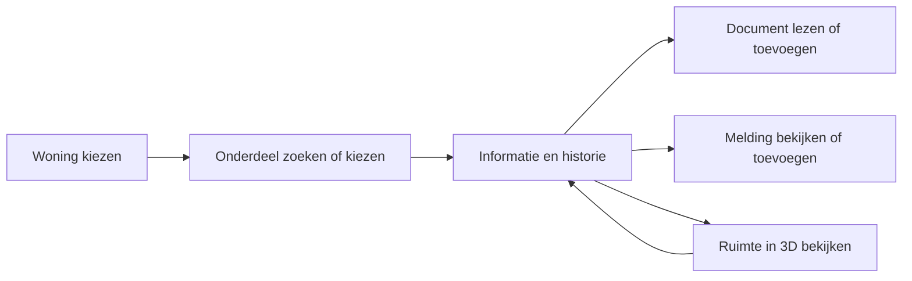
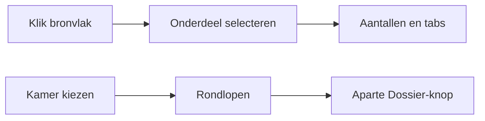
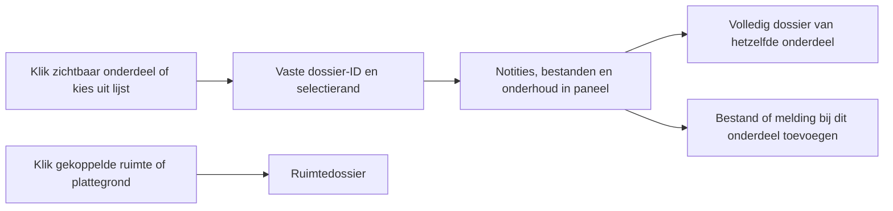

# Huisdossier: structuur en vormgeving

Gecontroleerd en bijgewerkt op 20 november 2026. Dit document beschrijft de werkende interface, de ontwerpkeuzes en de uitgevoerde review. Het is geen verklaring van volledige WCAG-conformiteit.

## Richting

- **Product:** bewoners vinden informatie, documenten en onderhoud terug bij een plek of onderdeel van hun woning.
- **Karakter:** rustig, precies en vertrouwd.
- **Wereld:** een werkdossier bij de plattegrond van je eigen huis.
- **Visueel middelpunt:** de echte woning en de eigen foto's; navigatie en panelen blijven terughoudend.
- **Herkenning:** dezelfde ruimte of hetzelfde onderdeel verbindt dossier, documenten, onderhoud en de ruimtelijke weergave.

De oorspronkelijke Huisdossier-conceptnotitie in de second brain beschrijft plaatsgebonden kennis als kern. De recente bewonersvragen voegen een uitgewerkt 3D-model toe. Daarom zijn dossier en ruimtelijke weergave beide rechtstreeks bereikbaar; documenten beheren vereist geen handeling in 3D.

## Navigatie en hoofdtaken

De woningselector bovenaan bepaalt het actieve dossier. De navigatie groepeert de pagina's op hun taak:

| Groep            | Pagina              | Gebruik                                                           |
| ---------------- | ------------------- | ----------------------------------------------------------------- |
| Dossier          | Overzicht           | Onderdeel vinden en de gekoppelde informatie bekijken             |
| Dossier          | Documenten & foto's | Bestanden zoeken, lezen, bekijken en downloaden                   |
| Dossier          | Onderhoud           | Open, uitgevoerde, wachtende en te controleren meldingen opvolgen |
| Woning verkennen | Buiten bekijken     | Gevel, dak en gebouw inspecteren                                  |
| Woning verkennen | Binnen kijken       | Ruimte kiezen, rondlopen en het ruimtedossier openen              |
| Achtergrond      | Bronnen & model     | Herkomst, detailniveau en aannames controleren                    |

De paginatitel noemt de huidige taak. Het adres staat in de woningselector. Exporteren staat als secundaire actie in de bovenbalk. De primaire toevoegactie hoort bij de pagina: onderdeel, bestand of melding. Een modelpagina heeft daardoor geen algemene uploadknop naast de titel.

Op desktop staat de gegroepeerde onderdelenlijst naast de geselecteerde inhoud. Ruimtes, gebouw, installaties en onderwerpen zijn uitklapbaar en doorzoekbaar. Op schermen tot 850 px vervangt een compacte native keuzelijst deze kolom. Na een keuze komt de inhoud in beeld.

De URL bewaart woning, pagina en gekozen onderdeel. De bestands- en onderhoudspagina bewaren ook zoekterm en relevante filters. Component-ID's uit een ander huis worden geweigerd. Een woningwissel wist de vorige selectie en opent het eigen buitenmodel. De terugknop herstelt de eerdere pagina en selectie.

## Ruimtelijke selectie als dossieringang

Een dak of gevel aanklikken houdt de buitenweergave open en selecteert het bijbehorende informatiepaneel. Oranje randen maken de selectie ook op de verfijnde geometrie zichtbaar. Een aanwijzer toont de naam vóór het klikken. Het overzicht toont notities, previews van maximaal drie gekoppelde bestanden en drie onderhouds-/historieregels; de tabs bevatten de volledige gekoppelde lijsten. **Volledig dossier bekijken** opent dezelfde vaste onderdeel-ID op de dossierpagina. Nieuwe bestanden/meldingen uit het paneel horen standaard bij dat geselecteerde onderdeel.

Op schermen tot 1000 px krijgt de paneeltitel na een modelklik focus en komt het paneel in beeld. **Terug naar 3D** gaat terug naar de viewer. De native onderdeelselector is een gelijkwaardige bediening zonder nauwkeurig aanwijzen. Interieur: een korte klik op een gekoppelde ruimte in het open overzicht of op de kleine plattegrond opent het ruimtedossier. De bestaande kamerknoppen blijven de ingang om rond te lopen; slepen in loopstand opent geen dossier.

Dit is selectie van het bestaande gezamenlijke dak-/geveldossier en van gekoppelde ruimtes. Afzonderlijke dakvlakken, gevelzijden, elk raam of ieder meubel zijn geen automatisch aangemaakte dossierobjecten. Dezelfde semantische koppeling kan later expliciete object-ID's gebruiken; de renderer verzint die inhoud niet.

Voor deze aanvulling:

Gecontroleerde nieuwe bediening:

Gecontroleerd op 20 november 2026; code in `spatialSelection.ts`, `Viewer.tsx`, `InteriorViewer.tsx` en `main.tsx`. Details van de browserproeven staan in [verificatie](verification.md).

## Vormgeving

| Rol                | Waarde                                                        |
| ------------------ | ------------------------------------------------------------- |
| Hoofdkleur / tekst | Navy `#1F2B35`                                                |
| Primaire actie     | Oranje `#F8891E`, met navy tekst                              |
| Woningweergave     | Crème `#F6F2E7`                                               |
| Werkruimte         | `#FAFAF7`, witte inhoudsvlakken                               |
| Secundaire tekst   | `#59645F`                                                     |
| Scheiding          | `#DEDFD9`                                                     |
| Lettertype         | Lokaal Inter, hoofdzakelijk 400/500, 600 voor beperkte nadruk |
| Iconen             | Lucide; navigatie 18 px, tekstacties 16 px                    |
| Ritme              | 4/8 px; paginamarge 32 px desktop, 24 px tablet, 16 px mobiel |

Navy tekst op oranje heeft ongeveer 5,90:1 contrast. Wit op dit oranje heeft ongeveer 2,45:1 en wordt niet als knoptekst gebruikt. Deze waarden zijn opnieuw berekend uit relatieve luminantie; de oudere contrasttabel in de merknotitie is geen betrouwbare meetbron.

Selectie in de navigatie gebruikt een rustige navy tint met een kleine oranje markering. Oranje is vooral voor de primaire actie. Getallen krijgen tabulaire cijfers. Inhoud krijgt meer ruimte dan navigatie. Kaders scheiden functionele werkvlakken; niet ieder gegeven krijgt een eigen kaart.

## Kritische review en oplossingen

| Bevinding vóór de herwerking                                       | Gevolg                                         | Oplossing                                                                         |
| ------------------------------------------------------------------ | ---------------------------------------------- | --------------------------------------------------------------------------------- |
| Adres als titel op iedere pagina, met dezelfde algemene ondertitel | Huidige taak onduidelijk                       | Taakgerichte titel, woningcontext in selector                                     |
| Alle onderdelen zowel in zijbalk als in een grote tegelwand        | Dubbele navigatie en veel concurrerende doelen | Vaste hoofdnavigatie, één gegroepeerde onderdelenlijst                            |
| Geselecteerde dossierinhoud onder een lange tegelwand              | Veel scrollen voor informatie                  | Inhoud naast de lijst; compacte mobiele selector                                  |
| Grote generieke PDF-kaarten en afgekorte titels                    | Weinig bestanden tegelijk te beoordelen        | Leesbare lijst met volledige titel, onderwerp en samenvatting; galerij op verzoek |
| Lange meldingen als voortdurend zichtbare tekst                    | Status, plek en datum moeilijk te scannen      | Samenvattingsrij; toelichting en bron uitklapbaar                                 |
| Algemene uploadactie op elke pagina                                | Acties volgen de context niet                  | Toevoegactie per dossierpagina, export rustig in bovenbalk                        |
| Lichtinstellingen over volle breedte en dubbele aanzichtknoppen    | Bediening domineert het huis                   | Compacte instellingenstrook; aanzichten op één plek                               |
| Pagina's alleen als buttons; terugknop herstelt de route niet      | Onvoorspelbare navigatie                       | Echte links, browsergeschiedenis en herstel van URL-selectie                      |
| Lege filterresultaten lijken op een leeg nieuw dossier             | Onduidelijke vervolgstap                       | Uitleg over selectie met expliciet filters wissen                                 |
| Mobiel menu zonder afgeschermde focus                              | Toetsenbord kan achter het menu terechtkomen   | Focus begrensd, achtergrond inert, Escape en focusherstel                         |

## Uitwerking per ontwerplaag

1. **Afstanden:** één ritme voor navigatie, koppen, filters, lijsten en werkvlakken.
2. **Kleur:** navy/crème behouden; accenten en secundaire tekst beperkt en benoemd.
3. **Iconen:** Lucide behouden; dubbele dak- en gevelknoppen verwijderd omdat het aanzichtmenu die acties bevat.
4. **Tekst:** concrete paginanamen, acties en lege toestanden; technische importcommando's uit de laadfout verwijderd.
5. **Typografie:** minder concurrerende koppen; leesbare metadata en volledige bestandsnamen.
6. **Indeling:** vaste taaknavigatie, dossier met lijst en inhoud, bibliotheek als lijst/galerij.
7. **Details:** zichtbare actieve toestand, zoekfocus op de hele zoekbalk, rustige tellingen en uitklapbare broninformatie.
8. **Beelden:** het bestaande huis en de eigen beelden dragen de visuele rijkdom. Geen decoratieve AI-afbeeldingen toegevoegd.
9. **Beweging:** geen nieuwe automatische animaties; bestaande reduced-motion-ondersteuning behouden. Mobiel scrollt de gekozen inhoud naar een bruikbare positie.

## Code en onderhoud

- `src/WorkspaceChrome.tsx`: navigatiegroepen, woningselector, paginatitels en contextacties; één bron voor de pagina-informatie.
- `src/DossierHome.tsx`: gegroepeerde onderdelen, mobiele selector en gekoppelde dossierinhoud.
- `src/FileLibrary.tsx`: gedeelde bestandslijst/galerij voor bibliotheek en inspectiepaneel. De hoofdweergave bewaart de gekozen lijst/galerij tijdens asynchroon zoeken.
- `src/houseSelection.ts`: herstel en serialisatie van woning-, pagina- en dossierselectie.
- `src/workspace.css`: vormgeving van de werkruimte en de bijbehorende schermbreedtes. `src/style.css` behoudt de bestaande formulieren en gespecialiseerde viewerbediening. 54 ongebruikte regels voor de vervangen navigatie en bestandstegels zijn verwijderd.

## Bronnen en toepassing

De lokale productcontext en merkbestanden bepalen wat deze app is. Externe richtlijnen helpen de uitvoering beoordelen:

- [Nielsen Norman Group: 10 usability heuristics](https://www.nngroup.com/articles/ten-usability-heuristics/): consistente benamingen, herkenbare keuzes, beperkte visuele ruis en herstelbare navigatie. Toegepast op de taakgroepen, paginatitels en filters.
- [W3C APG: modal dialog pattern](https://www.w3.org/WAI/ARIA/apg/patterns/dialog-modal/): focus binnen een modal houden, Escape aanbieden en focus teruggeven. Toegepast op het mobiele navigatiepaneel; bestaande invoervensters gebruiken native `dialog`.
- [Carbon: empty states](https://www.carbondesignsystem.com/building-blocks/core/patterns/empty-states): leg in de lege context uit wat er ontbreekt en welke stap beschikbaar is. Toegepast op zoekresultaten en een nog ontbrekend interieur.
- [Vercel Web Interface Guidelines](https://github.com/vercel-labs/web-interface-guidelines/blob/main/command.md): semantische links, toegankelijke namen, zichtbare focus, URL-staat en overloopcontrole.

De herwerking gebruikt de werkwijze van **unslop**, door [Damir Sokolovsky](https://heydamir.design/unslop), CC BY 4.0, naast de frontend-design- en web-design-guidelines-skills. De UI en CSS zijn voor dit project geschreven.

## Verificatie en grenzen

49 tests en TypeScript/productiebuild slagen. De nieuwe routecontrole dekt component-ID's van andere woningen, zoektermen met speciale tekens, filterherstel en het verwijderen van irrelevante filters op andere pagina's.

Alle zes pagina's gecontroleerd op 320, 390, 768 en 1440 px: geen horizontale pagina-overloop en geen naamloze actieknoppen. Daarnaast gecontroleerd: onderdeel kiezen/herladen, kamer → 3D → terug, zoekterm en woning herstellen met de terugknop, galerij behouden tijdens zoeken, lege selectie wissen, document openen/Escape, uploadvenster openen zonder wijzigingen te bewaren, beide inrichtingsstanden, badkamerdeur en lichtpaneel. Het mobiele menu begrenst Tab/Shift+Tab, sluit met Escape, herstelt focus en sluit bij omschakelen naar desktop. Affligem toont eigen gegevens en een lege interieurtoestand. Geen consolefouten of waarschuwingen tijdens deze browsercontroles.

Dit is een ontwerp- en gebruikscontrole met functionele proeven, geen volledige audit met schermlezers of alle mogelijke documentformaten. De bestaande waarschuwing over de omvang van de gedeelde Three.js-bundel blijft bestaan. De ruimtelijke nauwkeurigheid en bronbeperkingen van de huisprofielen veranderen niet door deze herwerking.
