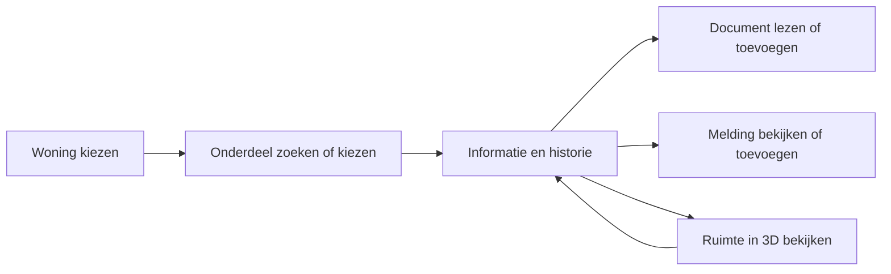
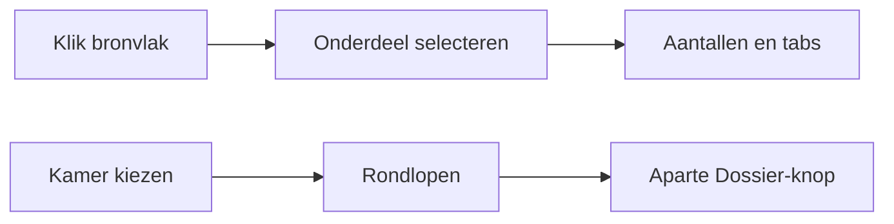
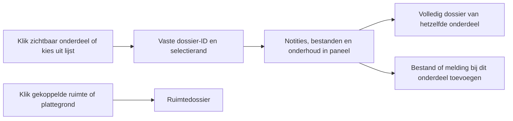

# Huisdossier: structuur en vormgeving

Bijgewerkt op 21 november 2026. De huidige richting en brede beoordeling staan in [de gebruiks- en ontwerpmatrix](usability-matrix.md). De gedateerde kleuranalyse hieronder beschrijft de eerdere uitvoering van 20 november; de nieuwste kleurwaarden staan in `src/design-tokens.css`. Dit is geen verklaring van volledige WCAG-conformiteit.

## Richting

Hulp bij bewaren, 21 november: `CaptureHelp` vervangt de gewone uitklaptekst door een zichtbaar driestappenbeeld. De eerste kaart volgt de invoersoort, de tweede toont de gekozen plek, de derde het concrete opgeslagen resultaat. Voorbeelden zijn fictieve invoerhulp; ze worden niet opgeslagen. De status na bewaren heeft geen overbodige hulp eronder. De voorstellen voor kosteninzicht en andere uitbreidingen staan afzonderlijk in [de gebruiksmatrix](usability-matrix.md#hulp-en-mogelijke-uitbreidingen-21-november-2026); zij zijn nog geen geïmplementeerde functies.

Informatie als losse gegevens, 21 november: de grote samengevoegde bron- en modelparagrafen zijn niet langer de hoofdweergave. Binnen, Bronnen en het informatietabblad van een ruimte delen een kennisboek met ruimtekeuze, directe onderwerpen, zoeken en vier zichtbare kaartjes per keer. Waarden staan groot; herkomst en status blijven direct erbij. De buitenafwerking verschijnt ook bij het betreffende gebouw-, dak- of geveltype. De bronnenpagina gebruikt de volle breedte en heeft luchtfotoherkomst, datum, resolutie en licentie als losse velden. Lange vrije notities, documentuitleg, klusresultaten en contactnotities gebruiken een gedeelde leesweergave. Zie [het informatieformaat](information-structure.md). De oorspronkelijke profieltekst blijft behouden en bereikbaar; de vormgeving verheft een benadering niet tot een bronfeit.

Huiselijker huisboek, 21 november: het grote echte 3D-model staat op de start los van de buurvolumes. De instellingen van de volledige buitenweergave blijven behouden. Naast het model staat één ruime fotopostkaart met de nieuwste expliciet gekozen PNG/JPEG/WebP/GIF/AVIF (categorie `photos`) en de bijbehorende plek; aanklikken opent het origineel in het bestaande fotovergrootvenster. Zonder foto verschijnt een decoratief albumstilleven. Klussen en aantallen bepalen niet langer de start: de praktische routes staan rustig onder het model. Plekken hebben grotere fotokaarten en krijgen hun eigen nieuwste foto als die beschikbaar is. Invoer begint bij foto/document, gevolgd door idee/notitie, klus en uitgevoerd werk. Een bestaand concept blijft bewaard. Plekkeuze gebruikt zichtbare knoppen; wie iets bewaarde is optioneel open te klappen. Dit is een ontwerpantwoord op de bewonersfeedback, geen gemeten tevredenheid.

### Decoratieve albumillustratie

Lokaal bestand: `public/illustrations/thuisalbum.png` (1536 × 1024, transparant). Gemaakt met de ingebouwde `image_gen` via de vaardigheid `imagegen`. Alleen decoratief: geen bronbeeld van de woning, de planten, inrichting of bewoners. Het model blijft brongeometrie; zelfgekozen huisboekfoto's vervangen deze uitnodiging. Bij het uploaden staat **Ook in mijn fotohoekje tonen** standaard uit. Een scan wordt niet automatisch een persoonlijke foto; bestaande afbeeldingen kunnen via de documentgegevens de categorie **Foto's van thuis** krijgen.

Generatieprompt:

> Use case: stylized-concept. Create one polished editorial 3D still life illustration as a transparent PNG cutout for a friendly personal house journal web app. A cozy little tabletop grouping: a lush small rubber plant in a matte sage ceramic pot, an orange ceramic tea mug, a closed cream linen photo album with a navy spine and two blank loose instant-photo backs resting on it (no imagery, no labels), and a small butter-yellow cushion leaning behind the album. Soft tactile paper, felt and ceramic textures, warm soft daylight, charming crafted rounded objects with thoughtful asymmetry, sophisticated playful Dutch design, not a corporate icon and not glossy plastic. A three-quarter elevated view, compact horizontal composition, all objects fully inside generous transparent margins. Main palette navy #1f2b35, warm orange #f8891e, sage #92ac85, butter yellow #f8e8ab, cream #f6f2e7. No house, no room architecture, no people, no text, no logo, no UI, no extra background or floor plane. True alpha background; just gentle contact shadows under objects. Intended as a decorative invitation to keep photos and memories; must not look like a verified rendering of a user's home.

### Eerdere uitwerkingen

Nieuwste gerichte uitwerking op 21 november: het keukendossier liet ondanks meer kleur nog te veel losse secties zien. `RoomDossier.tsx` vervangt dat door een kamerportret uit het bestaande 3D-profiel en vier vaste inhoudskeuzes: Overzicht, Foto’s & documenten, Klussen & historie en Info & contacten. Het overzicht toont bewaarde stukken en maximaal twee open of laatst afgeronde klussen. Lange informatie en het contactbeheer staan bij hun eigen keuze. Het kamerportret gebruikt dezelfde interieurrenderer met invoer uitgeschakeld; de enige 3D-actie opent de bestaande kamer. Zonder passende plattegrond blijft het bronpanddiagram beschikbaar. Geen nieuwe geometrie of bronclaims.

Planning gebruikt `CalendarMonth.tsx` en `calendar.ts`: een maandag-eerst-maandkalender, geplande dagen met markeringen, dagselectie met gekoppelde klussen, maandwissels en Vandaag. Persoonskeuze filtert kalender én lijst. Over datum, Nog te plannen en Alles blijven direct bereikbaar. Op smalle schermen brengt een dagkeuze de bijbehorende agenda in beeld. Export, kosten en herinneringsinstellingen zijn samengebracht bij Agenda, herinneringen & kosten. De bestaande kalenderexport blijft een momentopname.

- **Product:** bewoners vinden informatie, documenten en onderhoud terug bij een plek of onderdeel van hun woning.
- **Karakter:** warm, nieuwsgierig en vrolijk.
- **Wereld:** een persoonlijk huisboek met bewaarde foto's, verhalen en praktische informatie.
- **Visueel middelpunt:** het echte, draaibare woningmodel op de startpagina. Dak/gevel aantikken opent het bestaande onderdeel. Zonder bronmodel blijft de symbolische huisillustratie een decoratieve terugval, geen reconstructie.
- **Tablet in huis:** groot beeld, korte labels en ruime aanraakdoelen. Op 701–1180 px maakt de zijbalk ruimte voor het huis; foto’s/documenten, klussen en planning staan als drie grote acties onder het beeld.
- **Alle pagina’s:** documentpostkaarten, gekleurde klussen, kalenderblaadjes bij geplande taken, personenkaarten en vier grote invoersoorten. Een axonometrische SVG van uitsluitend de geïmporteerde buitenschil brengt iedere inhoudspagina terug naar 3D. Diagramkleuren stellen geen geverifieerde bouwmaterialen voor.
- **Herkenning:** dezelfde ruimte of hetzelfde onderdeel verbindt dossier, documenten, onderhoud en de ruimtelijke weergave.

De oorspronkelijke Huisdossier-conceptnotitie in de second brain beschrijft plaatsgebonden kennis als kern. De nieuwste bewonersvraag maakt 3D het centrale vertrekpunt en noemt een tablet in huis als gebruikssituatie. De plekkenlijst en document-/kluspagina’s blijven daarnaast rechtstreeks bereikbaar.

De uitvoering staat in `HouseAtlas.tsx`, `house-atlas.css` en de bestaande pagina’s. `SpatialHome` gebruikt dezelfde lazy geladen `Viewer` en vaste dossier-ID’s als de buitenpagina. `HouseMiniature` projecteert bestaande doelpandvlakken, inclusief openingen; inhoudspagina’s starten geen tweede WebGL-scène. `PlaceFilter` biedt bestaande onderdelen als zichtbare pictogramknoppen. Bestanden starten in galerijweergave; lijstweergave blijft beschikbaar. Aanzichten en planningpersonen zijn directe knoppen. Uitleg bij invoer en lokale personen staat op verzoek open.

## Navigatie en hoofdtaken

De woningselector bovenaan bepaalt het actieve dossier. De navigatie groepeert de pagina's op hun taak:

| Groep            | Pagina              | Gebruik                                                           |
| ---------------- | ------------------- | ----------------------------------------------------------------- |
| Van je huis      | Mijn huis           | Het huis draaien, onderdeel aantikken of een plek zoeken        |
| Van je huis      | Iets toevoegen      | Melding, notitie, bestand of uitgevoerd werk bewaren             |
| Van je huis      | Verzameling         | Foto’s en documentkaarten zoeken, lezen en downloaden            |
| Van je huis      | Klussen / Planning  | Werk opvolgen en plannen                                       |
| Even rondkijken  | Buiten bekijken     | Gevel, dak en gebouw inspecteren                                |
| Even rondkijken  | Binnen kijken       | Ruimte kiezen, rondlopen en het ruimtedossier openen            |
| Goed geregeld   | Beheer / Bronnen & model | Personen, afspraken, herkomst en beperkingen bekijken       |

De paginatitel noemt de huidige taak. Het adres staat in de woningknoppen. Exporteren staat als secundaire actie in de bovenbalk. De start biedt **Iets bewaren**, een groot interactief huis, **Buiten verkennen**, indien beschikbaar **Binnen kijken**, en drie inhoudsacties. **Onderdeel toevoegen** staat bij de plekken. Bestanden en onderhoud hebben hun eigen toevoegactie.



Het overzicht toont bestaande plekken, met ruimtes eerst: drie kolommen op desktop, twee op smallere schermen. Zoekveld en zichtbare categorieknoppen werken op de hele verzameling. **Alles**, **Kamers**, **Gebouw**, **Techniek** en **Overig** hebben een eigen pictogram en een zachte kleur; niet-aanwezige categorieën ontbreken. Zonder filter staan maximaal acht plekken in beeld; de rest is uit te vouwen. Een gekozen plek opent als aparte detailweergave met focus, zonder omslag of plekkenlijst erboven. **Terug naar alle plekken** herstelt de lijst en de gebruikte zoekkeuze. Een URL met een geldige `part` opent direct het detail; zonder `part` blijft het overzicht zichtbaar. De browserterugknop werkt tussen overzicht en plek. Woningkeuze en navigatie zijn direct zichtbare knoppen/links, zonder keuzelijst of uitklapgroep op de startpagina. Op mobiel opent de menuknop dezelfde directe links.

De URL bewaart woning, pagina en gekozen onderdeel. De bestands- en onderhoudspagina bewaren ook zoekterm en relevante filters. Component-ID's uit een ander huis worden geweigerd. Een woningwissel wist de vorige selectie en opent het eigen buitenmodel. De terugknop herstelt de eerdere pagina en selectie.

## Ruimtelijke selectie als dossieringang

De binnenweergave gebruikt nu op alle breedtes de volledige werkruimte. De vroegere smalle rechterkolom is vervangen door een kamerkeuze onder het model: grotere plattegrond, brede kaarten en afzonderlijke acties voor Binnen kijken en Foto’s, info & klussen. Lange namen breken af binnen de kaart. **Kamers kiezen** brengt focus naar de kamerkeuze; een kamer bekijken brengt focus en beeld weer naar de 3D-viewer, ook op desktop. Bronnen en maten staan op verzoek open. Uitwerking: `interior-workspace.css` en `InteriorViewer.tsx`.

Actuele tabletuitwerking: de start opent na een korte modeltik direct het detail; de gespecialiseerde buitenpagina behoudt het informatiepaneel. De hieronder beschreven native onderdeelselector is inmiddels vervangen door zichtbare pictogramknoppen. De eerdere kleur- en indelingsanalyse verderop blijft een verslag van de vorige uitvoering.

Een dak of gevel aanklikken houdt de buitenweergave open en selecteert het bijbehorende informatiepaneel. Oranje randen maken de selectie ook op de verfijnde geometrie zichtbaar. Een aanwijzer toont de naam vóór het klikken. Het overzicht toont notities, previews van maximaal drie gekoppelde bestanden en drie onderhouds-/historieregels; de tabs bevatten de volledige gekoppelde lijsten. **Volledig dossier bekijken** opent dezelfde vaste onderdeel-ID op de dossierpagina. Nieuwe bestanden/meldingen uit het paneel horen standaard bij dat geselecteerde onderdeel.

Op schermen tot 1000 px krijgt de paneeltitel na een modelklik focus en komt het paneel in beeld. **Terug naar 3D** gaat terug naar de viewer. De native onderdeelselector is een gelijkwaardige bediening zonder nauwkeurig aanwijzen. Interieur: een korte klik op een gekoppelde ruimte in het open overzicht of op de kleine plattegrond opent het ruimtedossier. De bestaande kamerknoppen blijven de ingang om rond te lopen; slepen in loopstand opent geen dossier.

Dit is selectie van het bestaande gezamenlijke dak-/geveldossier en van gekoppelde ruimtes. Afzonderlijke dakvlakken, gevelzijden, elk raam of ieder meubel zijn geen automatisch aangemaakte dossierobjecten. Dezelfde semantische koppeling kan later expliciete object-ID's gebruiken; de renderer verzint die inhoud niet.

Voor deze aanvulling:



Gecontroleerde nieuwe bediening:



Gecontroleerd op 20 november 2026; code in `spatialSelection.ts`, `Viewer.tsx`, `InteriorViewer.tsx` en `main.tsx`. Details van de browserproeven staan in [verificatie](verification.md).

## Vormgeving

| Rol                | Waarde                                                        |
| ------------------ | ------------------------------------------------------------- |
| Hoofdkleur / tekst | Navy `#1F2B35`                                                |
| Primaire actie     | Oranje `#F8891E`, met navy tekst                              |
| Woningweergave     | Crème `#F6F2E7`                                               |
| Werkruimte         | Papier `#FAF8F2`, witte inhoudsvlakken `#FFFFFF`               |
| Secundaire tekst   | `#52616B`; metadata `#5F6D76`                                 |
| Tekstacties        | Inktblauw `#304E60`, onderstreept                             |
| Scheiding          | `#DEDDD3`; invoerranden `#7E8A91`                             |
| Lettertype         | Lokaal Inter, hoofdzakelijk 400/500, 600 voor beperkte nadruk |
| Iconen             | Lucide; navigatie 18 px, tekstacties 16 px                    |
| Ritme              | 4/8 px; paginamarge 32 px desktop, 24 px tablet, 16 px mobiel |

Navy tekst op oranje heeft ongeveer 5,90:1 contrast. Wit op dit oranje heeft ongeveer 2,45:1 en wordt niet als knoptekst gebruikt. Deze waarden zijn opnieuw berekend uit relatieve luminantie; de oudere contrasttabel in de merknotitie is geen betrouwbare meetbron.

De navigatie heeft een zachte geselecteerde achtergrond met navy tekst. Oranje markeert de hoofdactie **Iets toevoegen**. Na nieuwe bewonersfeedback op de keuzelijsten gebruikt de interface direct zichtbare, gekleurde categorieknoppen en witte plekkaartjes met passende Lucide-pictogrammen. Een bedpictogram bij een kamer met 'slaapkamer' in de naam is herkenning van het label, geen verificatie van de inrichting. De eigen huisillustratie is met `imagegen` gegenereerd op 21 november 2026 en staat lokaal in `public/illustrations/huisvriend.png` (1536 × 1024, circa 2,36 MB, transparante achtergrond). Zij is decoratief en verborgen voor hulptechnologie; de woningmodellen blijven afzonderlijk gebaseerd op hun echte bronnen. De nieuwe referenties zijn [Headspace](https://www.headspace.com/) voor illustratief karakter en [Daylio](https://daylio.net/) voor direct aanwijsbare pictogramkeuzes. Geen externe beelden of fonts worden tijdens appgebruik opgehaald. De volledige beoordeling en grenzen van de browserproef staan in [de matrix](usability-matrix.md).

### Kleuranalyse en verfijning, 20 november 2026

De richting blijft een zorgvuldig, rustig en persoonlijk woningdossier. De visuele wereld is bouwtekening en dossierpapier: navy voor houvast, neutrale werkvlakken voor langdurig gebruik, crème rond de woningweergave en een kleine oranje markering bij de actieve keuze. De echte woning, foto's en 3D-details dragen de rijke kleur. Dit is een gerichte verfijning van Geokari, geen vervanging van logo, lettertype of ruimtelijke materialen.

De audit vond verspreide kleurdefinities in vier stylesheets, veel bijna gelijke grijsgroene metadatakleuren, bruine tekstacties die op lange lijsten te veel nadruk kregen, zwakke invoerranden en één amberkleur voor meerdere onderhoudsstatussen. De kleurwaarden zaten bovendien zowel in de basisstijl als de werkruimtestijl. De oplossing gebruikt één palet in `src/design-tokens.css`, met vaste rollen voor tekst, oppervlakken, interactie en status. 151 bestaande kleurwaarden zijn in de eerste stap naar deze rollen vertaald; de overige vaste interfacekleuren zijn daarna eveneens gecentraliseerd. Gespecialiseerde 3D-bronkleuren zijn niet opnieuw ingekleurd.

| Combinatie / rol                         | Gemeten contrast | Toepassing                                                                         |
| ---------------------------------------- | ---------------- | ---------------------------------------------------------------------------------- |
| Navy `#1F2B35` op wit                    | 14,43:1          | Hoofdtekst en titels                                                               |
| Secundair `#52616B` op wit               | 6,40:1           | Ondersteunende tekst                                                               |
| Metadata `#5F6D76` op wit / crème        | 5,34:1 / 4,77:1  | Bronvermelding, datums en voettekst                                                |
| Tekstactie `#304E60` op wit              | 8,81:1           | Links met onderstreping; hover wordt navy                                          |
| Navy op Geokari-oranje                   | 5,90:1           | Hoofdactie; witte tekst op dit oranje haalt 2,45:1 en wordt hiervoor niet gebruikt |
| Invoerrand `#7E8A91` op wit / werkruimte | 3,54:1 / 3,33:1  | Velden, keuzelijsten en zoekbalken                                                 |
| Selectierand `#A4601B` op selectievlak   | 4,49:1           | Herkenbare gekozen invoersoort / onderdeel, geen kleine tekstkleur                 |

De verhoudingen zijn berekend uit sRGB-luminantie, vóór afronding getoetst. [W3C tekstcontrast](https://www.w3.org/WAI/WCAG22/Understanding/contrast-minimum.html) vraagt voor gewone tekst minimaal 4,5:1; [niet-tekstcontrast](https://www.w3.org/WAI/WCAG22/Understanding/non-text-contrast.html) behandelt essentiële besturings- en toestandskenmerken met 3:1. Een scheidingslijn is iets anders dan een invoerrand: rustige lijnen tussen inhoudsvlakken hoeven geen formulierfunctie te suggereren.

De kleurrollen zijn ook functioneel doorgetrokken: **Open** krijgt warm amber, **Wacht op** een neutrale tint, **Controleren** gedempt blauw en **Afgerond** groen. De tekst blijft de betekenis noemen. Zoek- en formulierfocus gebruikt navy op lichte vlakken; in de donkere navigatie krijgt toetsenbordfocus oranje. Checkboxes en lichtschuiven gebruiken navy voor de bedienbare indicator. Hoofdknoppen hebben een vaste hover-/druktoestand; gewone tekstacties concurreren minder met die knoppen.

De typografie behoudt Inter: paginatitels 30 px op desktop en 26 px op mobiel, gewone hoofdknoppen 14 px en 44 px hoog, metadata overwegend 12 px. Kleine koppen krijgen geen negatieve letterspatiëring. Mobiele invoer en planningkeuzes gebruiken 16 px tekst. Controle- en paneelradii en de belangrijkste tekstmaten hebben gedeelde tokens. Hiermee blijft het ritme gelijk tussen dossier, invoer, beheer en planning.

Gerichte reviewlocaties, inmiddels verholpen:

```text
src/style.css:1532 - voettekst had zwakke en afwijkende grijsgroene tekstkleuren; gebruikt nu de gedeelde tekstrollen
src/style.css:2092 - bruine tekstacties bepaalden lange onderhoudslijsten; gebruikt nu onderstreept inktblauw met een eigen hover
src/workspace.css:155 - woningkeuze was pas bij hover afgebakend; gebruikt nu een herkenbare keuzelijstrand
src/management.css:287 - formuliergrenzen waren circa 1,6:1; gebruikt nu de controlerand van 3,54:1 op wit
src/style.css:1414 - wachtend en te controleren werk deelden amber; hebben nu afzonderlijke kleurrollen met dezelfde tekstlabels
```

De eerste computed-style-scan op negen Koekoekstraat-pagina's markeerde 34 verschijningen onder de tekstgrens, verdeeld over 14 unieke voor-/achtergrondcombinaties. Na de verfijning markeert dezelfde scan geen combinaties onder de toepasselijke tekstgrens en geen gemeten invoerranden onder 3:1. Dit is een scan van zichtbare DOM-tekst met effen achtergronden, inclusief hoofd- en metadatatekst; geen certificering van de hele app. Canvasinhoud, beeldtekst, alle mogelijke gebruikersinhoud, disabled controls en volledige schermlezerbediening vallen buiten die uitspraak. Bronbeelden en ruimtelijke nauwkeurigheid blijven afzonderlijke onderwerpen.

## Kritische review en oplossingen

| Bevinding vóór de herwerking                                       | Gevolg                                         | Oplossing                                                                         |
| ------------------------------------------------------------------ | ---------------------------------------------- | --------------------------------------------------------------------------------- |
| Adres als titel op iedere pagina, met dezelfde algemene ondertitel | Huidige taak onduidelijk                       | Taakgerichte titel, woningcontext in selector                                     |
| Alle onderdelen zowel in zijbalk als in een grote tegelwand        | Dubbele navigatie en veel concurrerende doelen | Vaste hoofdnavigatie, één gegroepeerde onderdelenlijst                            |
| Geselecteerde dossierinhoud onder een lange tegelwand              | Veel scrollen voor informatie                  | Inhoud naast de lijst; compacte mobiele selector                                  |
| Grote generieke PDF-kaarten en afgekorte titels                    | Weinig bestanden tegelijk te beoordelen        | Leesbare lijst met volledige titel, onderwerp en samenvatting; galerij op verzoek |
| Lange meldingen als voortdurend zichtbare tekst                    | Status, plek en datum moeilijk te scannen      | Samenvattingsrij; toelichting en bron uitklapbaar                                 |
| Algemene uploadactie op elke pagina                                | Acties volgen de context niet                  | Toevoegactie per dossierpagina, export rustig in bovenbalk                        |
| Lichtinstellingen over volle breedte en dubbele aanzichtknoppen    | Bediening domineert het huis                   | Compacte instellingenstrook; aanzichten op één plek                               |
| Pagina's alleen als buttons; terugknop herstelt de route niet      | Onvoorspelbare navigatie                       | Echte links, browsergeschiedenis en herstel van URL-selectie                      |
| Lege filterresultaten lijken op een leeg nieuw dossier             | Onduidelijke vervolgstap                       | Uitleg over selectie met expliciet filters wissen                                 |
| Mobiel menu zonder afgeschermde focus                              | Toetsenbord kan achter het menu terechtkomen   | Focus begrensd, achtergrond inert, Escape en focusherstel                         |

## Uitwerking per ontwerplaag

1. **Afstanden:** één ritme voor navigatie, koppen, filters, lijsten en werkvlakken.
2. **Kleur:** navy/crème behouden; accenten en secundaire tekst beperkt en benoemd.
3. **Iconen:** Lucide behouden; dubbele dak- en gevelknoppen verwijderd omdat het aanzichtmenu die acties bevat.
4. **Tekst:** concrete paginanamen, acties en lege toestanden; technische importcommando's uit de laadfout verwijderd.
5. **Typografie:** minder concurrerende koppen; leesbare metadata en volledige bestandsnamen.
6. **Indeling:** vaste taaknavigatie, dossier met lijst en inhoud, bibliotheek als lijst/galerij.
7. **Details:** zichtbare actieve toestand, zoekfocus op de hele zoekbalk, rustige tellingen en uitklapbare broninformatie.
8. **Beelden:** het bestaande huis en de eigen beelden dragen de visuele rijkdom. Geen decoratieve AI-afbeeldingen toegevoegd.
9. **Beweging:** geen nieuwe automatische animaties; bestaande reduced-motion-ondersteuning behouden. Mobiel scrollt de gekozen inhoud naar een bruikbare positie.

## Code en onderhoud

- `src/design-tokens.css`: gedeeld Geokari-palet, semantische statussen, focus, tekstmaten en radii; vóór de componentstijlen geladen. Wijzig een kleurrol hier en controleer de combinaties opnieuw; voeg geen nieuwe lokale grijskleur toe voor hetzelfde doel.
- `src/WorkspaceChrome.tsx`: navigatiegroepen, woningselector, paginatitels en contextacties; één bron voor de pagina-informatie.
- `src/DossierHome.tsx`: gegroepeerde onderdelen, mobiele selector en gekoppelde dossierinhoud.
- `src/FileLibrary.tsx`: gedeelde bestandslijst/galerij voor bibliotheek en inspectiepaneel. De hoofdweergave bewaart de gekozen lijst/galerij tijdens asynchroon zoeken.
- `src/houseSelection.ts`: herstel en serialisatie van woning-, pagina- en dossierselectie.
- `src/workspace.css`: vormgeving van de werkruimte en de bijbehorende schermbreedtes. `src/style.css` behoudt de bestaande formulieren en gespecialiseerde viewerbediening. 54 ongebruikte regels voor de vervangen navigatie en bestandstegels zijn verwijderd.

## Bronnen en toepassing

De lokale productcontext en merkbestanden bepalen wat deze app is. Externe richtlijnen helpen de uitvoering beoordelen:

- [Nielsen Norman Group: 10 usability heuristics](https://www.nngroup.com/articles/ten-usability-heuristics/): consistente benamingen, herkenbare keuzes, beperkte visuele ruis en herstelbare navigatie. Toegepast op de taakgroepen, paginatitels en filters.
- [W3C APG: modal dialog pattern](https://www.w3.org/WAI/ARIA/apg/patterns/dialog-modal/): focus binnen een modal houden, Escape aanbieden en focus teruggeven. Toegepast op het mobiele navigatiepaneel; bestaande invoervensters gebruiken native `dialog`.
- [Carbon: empty states](https://www.carbondesignsystem.com/building-blocks/core/patterns/empty-states): leg in de lege context uit wat er ontbreekt en welke stap beschikbaar is. Toegepast op zoekresultaten en een nog ontbrekend interieur.
- [Vercel Web Interface Guidelines](https://github.com/vercel-labs/web-interface-guidelines/blob/main/command.md): semantische links, toegankelijke namen, zichtbare focus, URL-staat en overloopcontrole.
- [GOV.UK Design System: colour](https://design-system.service.gov.uk/styles/colour/): functionele kleurrollen om tekst, randen, focus en feedback voorspelbaar toe te passen. De Geokari-kleuren blijven de eigen merkbasis; de GOV.UK-paletwaarden zijn niet overgenomen.

De herwerking gebruikt de werkwijze van **unslop**, door [Damir Sokolovsky](https://heydamir.design/unslop), CC BY 4.0, naast de frontend-design- en web-design-guidelines-skills. De UI en CSS zijn voor dit project geschreven.

## Verificatie en grenzen

49 tests en TypeScript/productiebuild slagen. De nieuwe routecontrole dekt component-ID's van andere woningen, zoektermen met speciale tekens, filterherstel en het verwijderen van irrelevante filters op andere pagina's.

Alle zes pagina's gecontroleerd op 320, 390, 768 en 1440 px: geen horizontale pagina-overloop en geen naamloze actieknoppen. Daarnaast gecontroleerd: onderdeel kiezen/herladen, kamer → 3D → terug, zoekterm en woning herstellen met de terugknop, galerij behouden tijdens zoeken, lege selectie wissen, document openen/Escape, uploadvenster openen zonder wijzigingen te bewaren, beide inrichtingsstanden, badkamerdeur en lichtpaneel. Het mobiele menu begrenst Tab/Shift+Tab, sluit met Escape, herstelt focus en sluit bij omschakelen naar desktop. Affligem toont eigen gegevens en een lege interieurtoestand. Geen consolefouten of waarschuwingen tijdens deze browsercontroles.

Dit is een ontwerp- en gebruikscontrole met functionele proeven, geen volledige audit met schermlezers of alle mogelijke documentformaten. De bestaande waarschuwing over de omvang van de gedeelde Three.js-bundel blijft bestaan. De ruimtelijke nauwkeurigheid en bronbeperkingen van de huisprofielen veranderen niet door deze herwerking.
## Algemene handleiding — 21 november 2026

Een vaste Lucide-`Info`-knop in de bovenbalk opent **Wegwijs in je huisboek** op elke werkpagina. De algemene hulp staat los van de huisassistent. Zes zichtbare onderwerpen behandelen ontdekken, bewaren, terugvinden, klussen/agenda, mensen en vragen stellen. Elk onderwerp heeft drie korte stappen en één knop naar de betreffende pagina van de gekozen woning. De huidige pagina bepaalt het eerste onderwerp; een andere keuze vraagt geen dropdown. De footer legt de dossierkopie en bronzekerheid uit. Uitleg verschijnt alleen op verzoek en schrijft geen dossiergegevens.

`WorkspaceHelp.tsx` en `workspace-help.css` gebruiken de bestaande dialoog, Inter, Lucide en het huisboekpalet. De knop heeft een toegankelijke naam en een doel van minimaal 44 × 48 px; sluiten via kruisje, Escape of de knop onderaan herstelt de focus. Desktop en 320/390/768/1024 px zijn gecontroleerd zonder horizontale overloop. De contextkeuze, alle zes onderwerpen, de routeknoppen en aanwezigheid op alle tien pagina's zijn met geïsoleerde testgegevens gecontroleerd. 83 bestaande tests en productiebuild slagen; de bekende 3D-bundelwaarschuwing blijft.
