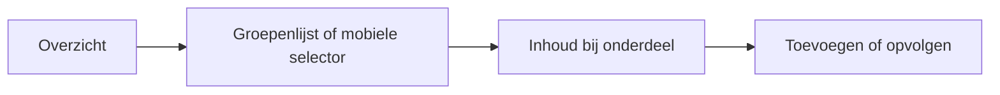
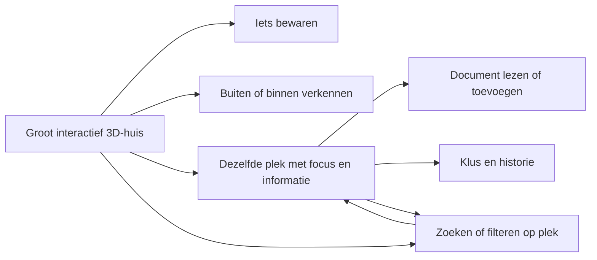

# Een vrolijk huisboek: ontwerp en gebruiksreview

21 november 2026. Aanleiding: de bewoner vindt de bestaande app saai en te veel op een managementtool lijken en vraagt om creatieve online voorbeelden, een beoordelingsmatrix en daadwerkelijke verbetering.

## Verfijning na bewonersfeedback

### Hulp en mogelijke uitbreidingen, 21 november 2026

**Uitgevoerd:** de kale hulpuitklapper is vervangen door drie geïllustreerde stappen in `CaptureHelp`: herkenbare invoer, gekozen plek en bewaard resultaat. Voorbeelden en uitleg volgen de vier invoersoorten. De hulp bevat geen extra formulieracties, verandert geen concept en verdwijnt na opslaan. Desktop heeft drie kaarten naast elkaar, mobiel drie compacte beeld-/tekstkaarten onder elkaar. 320/390/768/1024/1440 px gecontroleerd; 78 tests en build slagen.

**Onderzocht, nog niet gebouwd:** officiële productpagina's bekeken op 21 november 2026. [HomeZada Finances](https://www.homezada.com/homeowners/home-finances) brengt woonlasten en toekomstige uitgaven samen. [HomeZada Projects](https://www.homezada.com/homeowners/home-improvement) verbindt visuele ideeën met projecten, materialen en budgetten. [HomeBinder](https://pages.homebinder.com/agent-help-center-0) bewaart onder meer toestelgegevens, aankoop-/installatiegegevens en verfkenmerken. [HomeZada FAQ](https://www.homezada.com/faq) beschrijft onder andere voor-/nafoto's en onderhoudssjablonen. Dit zijn productbeschrijvingen, geen onafhankelijke effectmeting of reden om hun volledige managementstructuur over te nemen.

De volgende selectie is een eigen voorstel, afgestemd op een persoonlijk visueel huisboek. De gebruiker noemde een kostenmonitor als idee; dat is geen opdracht om alle onderstaande functies al te bouwen.

| Volgorde | Voorstel | Concreet gebruik | Wat is er al / wat ontbreekt? |
| --- | --- | --- | --- |
| 1 | Kostenmonitor **Geld voor je huis** | Grote maand-/jaarweergave, uitgaven per ruimte, betaald versus begroot en terugkerende woonlasten. Tik op een ruimte in 3D voor de bijbehorende uitgaven en bonnen. | Werkelijk betaalde onderhoudsbedragen en jaartotaal bestaan al. Maandtrend, zelfstandige uitgaven, vaste lasten, budgetten en kostencategorieën ontbreken. |
| 2 | **Huiswensen** met een spaarpot | Een beeldbord voor bijvoorbeeld een leeshoek of een tuinidee: foto's, producten, eigen doelbedrag en een volgende kleine stap. Koppel de wens aan een plek. | Notities en bewaarde foto's bestaan; een visueel wens-/projectobject, doelbedrag en productkeuzes ontbreken. |
| 3 | **Toen & nu** | Schuif twee eigen foto's over elkaar en bekijk de geschiedenis van één plek. | Foto's en uitgevoerde klussen bestaan; een gekozen voor-/napaar en tijdlijn ontbreken. Gebruik een opgegeven fotodatum; uploadtijd is geen opnamedatum. |
| 4 | **Toestelpaspoort** | Modelnummer, aankoop, installatie, garantieafspraak, bon en handleiding bij één apparaat. Een herinnering voor een vastgelegde garantiedatum. | Onderdelen, documenten en onderhoud bestaan. Getypeerde toestelvelden en garantie-einddatum ontbreken; een contract of lokale garantietekst bepaalt de echte dekking. |
| 5 | **Waar zit dat?** | Een directe huiskaart voor waterafsluiter, groepenkast, verfkleur en reserveonderdeel, met eigen detailfoto's. | Vaste onderdeel-ID's, optionele posities en kennisitems bestaan. Een snelle favorieten-/wegwijsweergave ontbreekt. Locaties mogen niet uit het model worden geraden. |

Een seizoenskaart met maximaal drie vrijwillige suggesties kan later op de bestaande onderhoudsafspraken voortbouwen. Een groot standaardtakenpakket voegt nu weinig toe: planning en terugkerend onderhoud werken al.

**Eerste versie kostenmonitor:** gebruik één uitgavenrecord als bron, gekoppeld aan een plek, eventueel een klus en bewijsstuk. Bewaar bedragen in centen. Een factuur én de gekoppelde klus tellen niet twee keer. Betaald, offerte/begroting en een spaardoel blijven aparte bedragen. Een vast termijnbedrag is een verwachting; het wordt niet stilzwijgend een betaalde transactie. Onbekende kosten blijven zichtbaar onbekend, ook naast een correct bekend totaal. Start met expliciete invoer en koppelingen; bankkoppeling en OCR zijn niet ingericht. De bestaande onderhoudskosten vormen een bruikbaar eerste onderdeel, geen volledig overzicht van de woonlasten.

De start houdt het huis en eigen beelden centraal. Kosteninzicht krijgt één rustige ingang bij Praktisch; wensen en herinneringen krijgen een plaats bij de eigen ruimtes. Deze uitbreiding mag niet opnieuw een wand met managementtellers worden.

Losse informatie: relevante maten, herkomst, bewonerscorrecties en modelaannamen stonden nog bij elkaar in lange paragrafen. Ze zijn nu zelfstandige kennisitems per bestaande ruimte en onderwerp. Binnen, Bronnen en kamerinfo delen dezelfde bediening. Vrije tekst is daarnaast op andere schermen leesbaar in punten gemaakt. Oorspronkelijke broninhoud blijft beschikbaar; herkomst en onzekerheid staan bij het afzonderlijke gegeven. Details en onderhoudsgegevens zijn niet automatisch geverifieerd door deze presentatie. Proeven met synthetische gegevens dekken ruimteafbakening, zoeken, oorspronkelijke tekst, export en smalle schermen. Geen nieuwe tevredenheidsscore toegekend.

Aanvullende feedback: ook de overzichtelijkere versie voelde vooral als werk. De start geeft nu het echte huis en één grote zelfgekozen fotopostkaart (categorie photos; een afbeeldingsscan wordt niet automatisch getoond) de hoofdrol. Een decoratief album met plant en kopje nodigt uit zolang er geen foto is. Klustellers en drie grote werkblokken zijn vervangen door rustige praktische routes; plekken gebruiken eigen foto’s waar aanwezig. Invoer begint met foto/document en idee/notitie, met directe plekknoppen. Nieuwe concepten starten bij foto/document; bestaand werk blijft herstelbaar. Huiselijkheid is hiermee een inhoudelijke keuze (eigen beelden en ideeën), naast kleur en vorm. De eerdere scores hieronder zijn ontwerpinschattingen; deze iteratie krijgt geen hogere score zonder bewonersbeoordeling.

Geïsoleerde controle: foto en notitie opslaan, juiste plek, foto vanaf de start openen, toetsenbordselectie zonder onbedoeld indienen, woningisolatie en desktop/tablet/mobiele indeling. 74 tests en productiebuild slagen. Geen private inhoud gebruikt voor schrijvende proeven.

Laatste gerichte bewonersfeedback: het specifieke keukendossier bleef rommelig en de datum/planningpagina kon overzichtelijker en visueel aantrekkelijker. Nieuwe uitvoering: één echt 3D-kamerportret, één ingang naar die kamer in 3D, vier vaste inhoudskeuzes en een compact overzicht. Notities en contacten staan bij Info & contacten. De planning is een echte maandkalender met aanklikbare dagen en een gekoppelde agenda, met afzonderlijke filters voor over datum en ongedateerde klussen. Hulpmiddelen staan bij elkaar. Dit is een structurele herindeling; er zijn geen nieuwe tevredenheidsmetingen of hogere ontwerpscores toegekend.

Gerichte controle met synthetische dossiers: beide pagina’s op 320/390/768/1024/1440 px zonder overloop. Kamerportret wordt echt gerenderd; het reageert niet op invoer. Fotovergrootvenster en documentlezer, inhoudskeuzes, contactdialoog, kamer → volledige 3D, vijf klussen op één dag, maandwissel, Vandaag, persoonsfilter, over datum en nog te plannen zijn gecontroleerd. Een opgeslagen testherinnering wijzigde de onderhoudsdatum niet. Twee nieuwe datumtests dekken schrikkeldag, maandag-eerst-weken, jaarwissel en DST. 72 tests en productiebuild slagen. De eerdere verwijzingen naar 70 tests en gestapelde detailblokken hieronder zijn historische stappen.

De nieuwste vraag maakt **het echte 3D-huis centraal** en noemt **een tablet in huis**: grotere elementen, direct weten waar je kunt tikken, minder tekst en rommel. De start toont daarom een groot interactief model met drie inhoudsacties. Alle inhoudspagina’s krijgen een axonometrisch diagram van de bestaande brongeometrie en een eigen visuele vorm: documentpostkaarten, kluskaarten, kalenderblaadjes, personenkaarten en grote invoerkeuzes. Het diagram gebruikt interfacekleuren en voegt geen bouwkundige claims toe. De eerdere AI-illustratie verschijnt alleen als er geen model is.

Op tablet maakt een smalle navigatie met pictogram én label ruimte voor het huis. Primaire acties zijn minimaal 48 px hoog; aanvullende touchbediening vergroot bij een grove aanwijzer mee. Uitleg bij invoer/personen is optioneel. Bestanden starten als galerij. Plekfilters, buitenaanzichten en planningpersonen hebben zichtbare knoppen. De 3D-first referentie is [Planner 5D](https://planner5d.com/); de eigen brongeometrie en Geokari-huisstijl bepalen de uitvoering.

Geïsoleerde controle: negen pagina’s op 320/768/1024/1440 px zonder pagina-overloop. Een synthetisch buitenmodel en twee gekoppelde lege testruimtes op 4191 dekken modeltik → dossier-ID, draaien zonder selecteren, ruimtedossier via plattegrond, documentlezer, plekfilters, galerij, afrondvenster, planningpersonen, huiswissel en ontbrekend interieur. Menufocus/Escape en detailindeling zijn ook op 390 px gecontroleerd. 70 tests en productiebuild slagen; de 3D-bundel houdt zijn bestaande omvangwaarschuwing. Dit is een lokale browsercontrole, geen benchmark op een echte tablet of gemeten bewonersvoorkeur.

### Eerdere stappen op dezelfde dag

De nieuwste feedback wijst keuzelijsten en uitklapgroepen expliciet af en vraagt om meer visueel enthousiasme. De actuele versie gebruikt daarom zichtbare woningknoppen, directe navigatielinks en gekleurde categorieknoppen met pictogrammen. De categorieën heten Alles, Kamers, Gebouw, Techniek en Overig. De startpagina heeft geen `select` of ingeklapte navigatiegroep meer. Nieuwe, op de officiële sites bekeken ontwerpreferenties: [Headspace](https://www.headspace.com/) en [Daylio](https://daylio.net/). De eigen, decoratieve huisillustratie is AI-gegenereerd met transparante achtergrond; zij is geen bronbeeld van een woning. Kamerpictogrammen volgen de naam van bestaande onderdelen en zeggen niets over geverifieerde meubels.

Geïsoleerde eindcontrole met twee synthetische woningen: categorie rechtstreeks kiezen, geselecteerde categorie behouden bij teruggaan uit een kamer, woningwissel met gescheiden dossierinhoud en mobiele directe navigatie. Alle negen pagina's op 320/768/1440 px zonder horizontale overloop. 70 tests en productiebuild slagen. De volgende alinea's en oudere scores beschrijven ook de afwegingen van de tussenversies; persoonlijke voorkeur voor de nieuwe vormgeving moet de bewoner beoordelen.

De eerste huisboekuitwerking werd nog als zwaar en complex ervaren. Daarom gebruikt de huidige versie een kleine illustratie op een open achtergrond, één oranje toevoegactie, compacte plekken met kleine pasteliconen en één categoriekeuze naast het zoekveld. De negen navigatiepagina's blijven bereikbaar, maar alleen vier dagelijkse links staan direct open. Nulbestanden worden niet bij iedere plek herhaald. Op mobiel zijn in de synthetische proef de eerste ruimtes direct zichtbaar; de grote omslag duwde ze eerder onder het eerste scherm.

De zwaarste stapeling verdwijnt ook functioneel: het overzicht toont geen standaard geopend gebouddossier meer. Na een keuze vervangt het ruimtedetail het overzicht. Een geldige `part`-link opent de plek direct, de terugknop herstelt de lijst en de browserterugknop werkt tussen deze twee toestanden. De zoekterm en categorie blijven bij teruggaan binnen dezelfde pagina behouden. Native detailsgroepen in het mobiele menu nemen alleen zichtbare links en samenvattingen mee in de focusbegrenzing.

Deze verfijning is met geïsoleerde testinhoud op desktop en mobiel bekeken. Gecontroleerd: overzicht zonder `part`, keuze → detail, browser terug, directe ruimtelink → document, terug naar de lijst, categoriekeuze en mobiel menu inclusief Shift+Tab/Tab en Escape. Negen pagina's op 320/768/1440 px hebben geen horizontale overloop. De onderstaande scores blijven ontwerpinschattingen; er zijn geen taakduurmetingen of nieuwe tevredenheidsscores van bewoners.

## Richting en bronnen

Een persoonlijk huisboek: warm, nieuwsgierig en vrolijk. Het dossier verzamelt verhalen, foto's, handleidingen en onderhoud rond een plek. De bestaande second-brainnotitie `Projects/Geokari/06_Huisdossier/01_Knowledge/business/concept-huisdossier.md` bevestigt plaatsgebonden kennis, historie en gebruik door minder technische bewoners als uitgangspunt. Het huisboek is een visuele richting, geen nieuwe productnaam of andere gegevensstructuur.

Online bekeken op 21 november 2026:

- [Kinopio](https://kinopio.club/): visueel verzamelen en een persoonlijke, speelse ruimte. De homepage is ook in de browser bekeken. Vertaling: een kleine huisboektekening en herkenbare pasteliconen bij plekken. Een plek blijft voorspelbaar terug te vinden.
- [mymind](https://mymind.com/): een privéverzameling voor notities en beelden. Vertaling: bewaren als uitnodigende hoofdactie, inhoud als vertrekpunt. De app krijgt hierdoor geen automatische ordening of AI-functionaliteit.
- [Are.na](https://www.are.na/): verzamelen en inhoud bij elkaar brengen. Vertaling: een rustige navigatie rond persoonlijke inhoud; geen sociale functies.
- [W3C tekstcontrast](https://www.w3.org/WAI/WCAG22/Understanding/contrast-minimum.html), [zichtbare focus](https://www.w3.org/WAI/WCAG22/Understanding/focus-visible.html) en [aanwijsdoelen](https://www.w3.org/WAI/WCAG22/Understanding/target-size-minimum.html): ondergrens voor leesbaarheid en bediening, ook bij een speels ontwerp.

Geokari blijft herkenbaar door het bestaande logo, lokaal Inter, Lucide, navy `#1F2B35`, oranje `#F8891E` en crème `#F6F2E7`. Papier `#FAF8F2`, botergeel `#F8E8AB`, zachtgroen `#DFEBE1`, lila `#E8E3F3` en perzik `#F9DECA` geven de omslag en categorieën karakter. De interfacekleuren staan in `src/design-tokens.css`; `src/housebook.css` bevat de nieuwe compositie. De SVG-omslag is een symbolische illustratie, geen weergave of verificatie van een echte woning.

## Beoordelingsmatrix

Dit is een kwalitatieve ontwerp- en interactiereview. **Voor/nu zijn inschattingen op een schaal van 1 tot 5**, waarbij 1 de taak belemmert, 3 bruikbaar maar stroef is en 5 overtuigend werkt. Het zijn geen gebruikersmetingen; vooral plezier, herkenning en de voorkeur voor deze richting moeten bewoners zelf beoordelen. Er is bewust geen schijnprecies totaalcijfer.

| Aspect | Voor → nu | Bevinding en verbetering | Controle / resterende vraag |
| --- | --- | --- | --- |
| Uitstraling en plezier | 2 → 4 | Groot echt 3D-huis, inhoudelijke pastelkleuren en eigen vormen voor documenten, klussen, personen en planning. | Desktop, tablet en mobiel bekeken; bewonersvoorkeur blijft te beoordelen. |
| Persoonlijke herkenning | 2 → 4 | De taal draait om thuis, bewaren en plekken. Bestaande ruimtes komen vóór generieke gebouwonderdelen. | Alleen bestaande dossieronderdelen worden getoond; de omslag verzint geen woningkenmerken. |
| Eerste gebruik | 3 → 4 | Draai/tik op het huis; grote acties openen verzamelen, klussen en planning. Binnen kijken verschijnt wanneer een plattegrond beschikbaar is. | Een dak aantikken opent het juiste bestaande dakdossier; draaien selecteert niets. |
| Vindbaarheid | 3 → 4 | Zoekveld en direct zichtbare categorieknoppen werken op desktop én mobiel. Woningkeuze en navigatie klappen niet uit. | Categoriekeuze en zoeken gebruiken alle plekken; twee testwoningen blijven gescheiden. |
| Rust bij veel inhoud | 3 → 4 | De start toont maximaal acht plekken. **Alle … plekken tonen** vouwt uit; zoeken en categoriefilters doorzoeken de hele verzameling. | Elf testonderdelen, lange naam, uit- en invouwen gecontroleerd. Honderden onderdelen vragen een aparte praktijktest. |
| Van plek naar informatie | 3 → 4 | Een selectie opent alleen het gekozen detail. **Terug naar alle plekken** brengt je terug; geen extra dossier onder de hele startpagina. | URL zonder/geldige `part`, browser terug, focus, directe link en document gecontroleerd. |
| Invoer en herstel | 4 → 4 | Bestaande conceptopslag en invoervalidatie blijven de basis. De vier invoersoorten krijgen gekleurde vlakken met een aparte selectierand. | Notitie met titel en tekst opgeslagen, bevestiging en juiste plek gecontroleerd. Ontbrekende verplichte tekst krijgt native validatie. |
| Feedback en begrijpelijkheid | 3 → 4 | Selectie heeft een rand én `aria-pressed`; het zoekresultaat wordt aangekondigd. Tellers gebruiken correct enkelvoud en meervoud. | Lege zoekopdracht, selectie en opslagbevestiging gecontroleerd. |
| Leesbaarheid | 4 → 4 | Grotere koppen geven hiërarchie. Functionele tekst blijft donker op lichte vlakken; navy op oranje blijft behouden. | Huidige meting: intro/pleknamen 13,59:1; toevoegknop 5,90:1; plekmetadata 6,03:1; actieve navigatie 12,85:1. |
| Toetsenbord en aanraken | 4 → 4 | Native knoppen, zichtbaar focuskader en 44 px hoge filters/hoofdacties. Geen sleepgebaar nodig voor de plekkenlijst. | Focus na selectie, menu/Escape en focusherstel gecontroleerd. Geen volledige schermlezeraudit. |
| Mobiel en tablet | 3 → 4 | Grote 3D-scène, drie ruime inhoudsacties en smalle tabletzijbalk; mobiel houdt twee kolommen met plekken. | Negen pagina’s op 320/768/1024/1440 px zonder overloop. Detail en menu ook op 390 px. |
| Betrouwbaarheid en bronbegrip | 4 → 4 | Plaats-ID's, oorspronkelijke bestanden, modelherkomst en ontbrekend interieur behouden hun eigen betekenis. De decoratieve omslag is verborgen voor hulptechnologie. | Documentlezer geopend; de synthetische testwoning heeft geen interieur en toont geen verzonnen interieur. |
| Privacy en eigenaarschap | 4 → 4 | Dit blijft een lokale toepassing met export en woninggebonden gegevens. Nieuwe vormgeving vraagt geen externe font-, beeld- of gegevensdienst op. | Browserproeven gebruiken een aparte tijdelijke database en een synthetisch model; geen echte dossierinhoud gewijzigd. |
| Prestaties en onderhoudbaarheid | 3 → 4 | De start hergebruikt de bestaande 3D-viewer; andere pagina’s gebruiken een SVG van bronvlakken. Geen tweede WebGL-scène of nieuw pakket. | Productiebuild slaagt. De bestaande 3D-bundel blijft groter dan 500 kB; geen apparaatbenchmark uitgevoerd. |

## Gecontroleerde route

Eerdere indeling:

Nieuwe indeling:

De actuele implementatie staat in `HouseAtlas.tsx`, `house-atlas.css` en de bestaande pagina’s. De nieuwste interactieve controle gebruikt twee tijdelijke dossiers met synthetische geometrie op 4191; de eerdere zoek-/invoerproeven op 4188/4189 blijven hierboven herkenbaar als tussenversies. Geen hernieuwde inhoudelijke validatie van private woninggeometrie of bronbeelden.

`npm test`: 70 geslaagd. `npm run build`: geslaagd; bestaande waarschuwing over de omvang van de 3D-bundel. Nog te valideren met bewoners: persoonlijke voorkeur, taakduur en vindbaarheid zonder uitleg, grotere dossiers en gebruik met een schermlezer. Dit is geen volledige WCAG-conformiteitsverklaring.

Deze review gebruikt craftprincipes uit [Unslop door Damir Sokolovsky](https://heydamir.design/unslop), CC BY 4.0, en de bestaande Geokari-ontwerpprincipes. De expliciete wens om vrolijker en creatiever te ontwerpen bepaalt de nieuwe richting.
